# Estante

Organizador de biblioteca que roda no proprio PS5, com navegacao pelo controle.
*A native PS5 library organizer with controller navigation, for jailbroken consoles.*

**English:** Estante ("shelf" in Portuguese) is a controller-driven PS5 library organizer with a Home catalogue, a cover-flow shelf, a searchable and filterable Library, game details, trophies when the console has local trophy data, and personal collections. It reads PS5/PS4 titles through Elf Arsenal and can import games from the standard `/data` folders of PS5SX2, SwanStationPS5, Porpoise, and PS5-ECAM. For imported emulator titles, Play opens the emulator; select the game inside it. USB/M.2 game folders are not imported; Nintendo Switch games come from ProsperoEden; 3DS/DS lists depend on ECAM having scanned them. Each emulator must have been opened at least once. It requires Elf Arsenal and ShadowMountPlus; only firmware 11.60 has been tested. The GPU interface uses OpenGL via [ps5-opengl](https://github.com/blackbearreloaded/ps5-opengl) and [ps5-homebrew-ui](https://github.com/blackbearreloaded/ps5-homebrew-ui), with 3D cases, cover flow, a launch animation, five color themes, and English/Portuguese/Spanish localization. Portrait covers can be added with `tools/ps5_covers_sync.py`; otherwise the app uses available square art. The app has its own home-screen background (selected and launching). The console only reads it when the app is registered, so if you update from an older version and the background does not show, uninstall Estante and install it again. Downloads and install notes: [latest release](https://github.com/kauansilvalopes/estante/releases/tag/v0.5.5).

## Screenshots

Rendered by the real draw code through the GPU renderer on a PC (Mesa) with placeholder covers (no game art is bundled). Build: `make` fetches the pinned ps5-opengl SDK on its own; `bash tools/preview-estante-gl.sh` renders every screen on the PC.

| Home | Library |
|---|---|
| 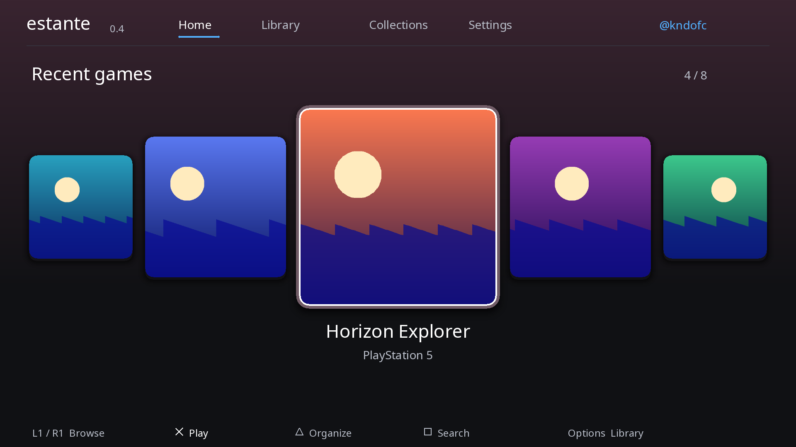 | 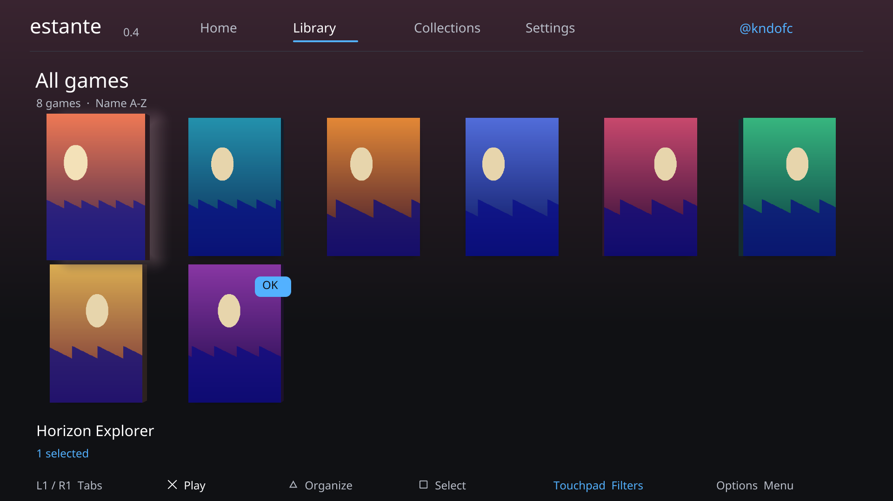 |
| **Filters (touchpad)** | **Collections** |
| 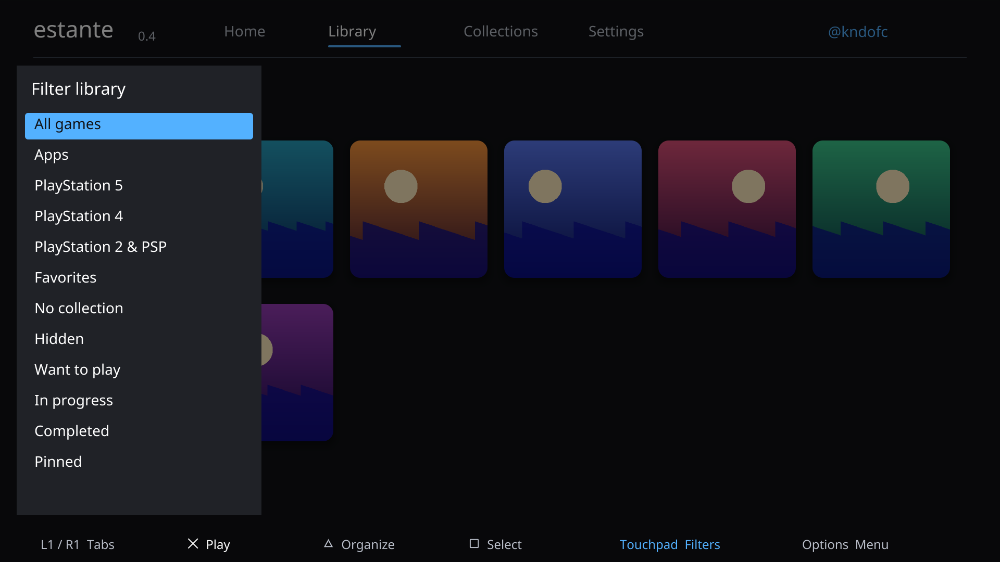 | 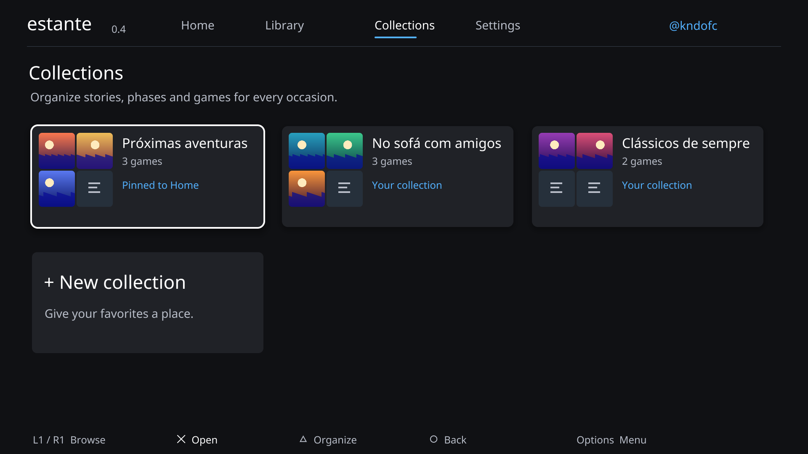 |
| **Game details** | **Organize menu** |
| 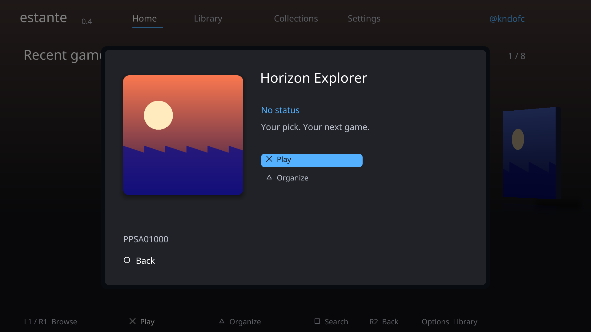 | 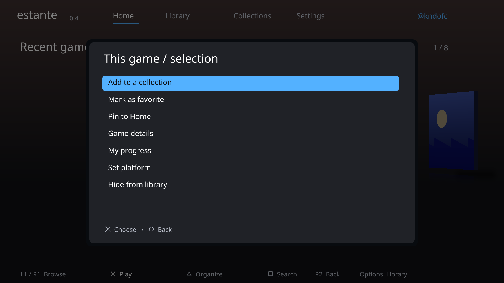 |
| **Apps** | **Settings** |
| 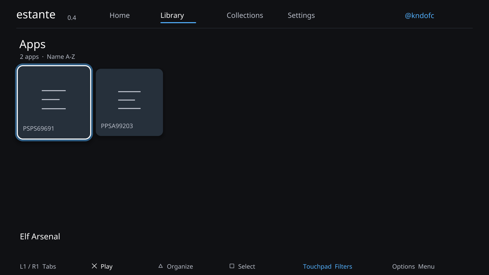 | 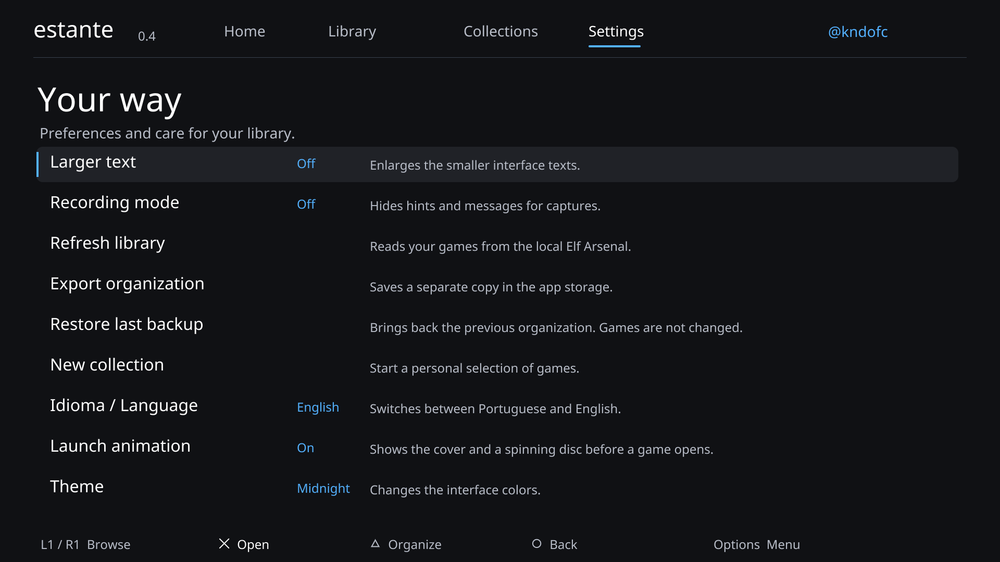 |
| **Case turned by the right stick (spine)** | **Back of the case (R2 / L2)** |
| 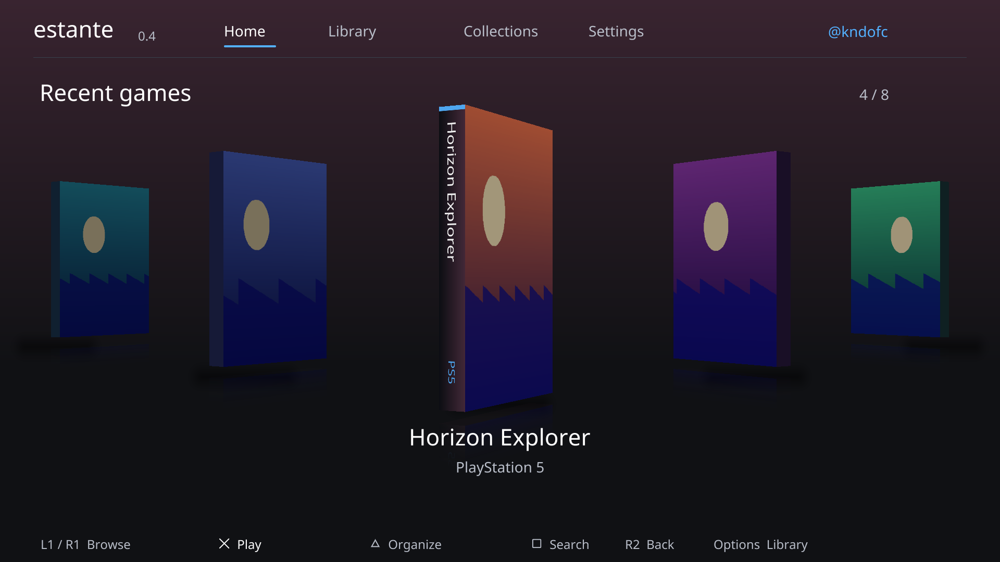 | 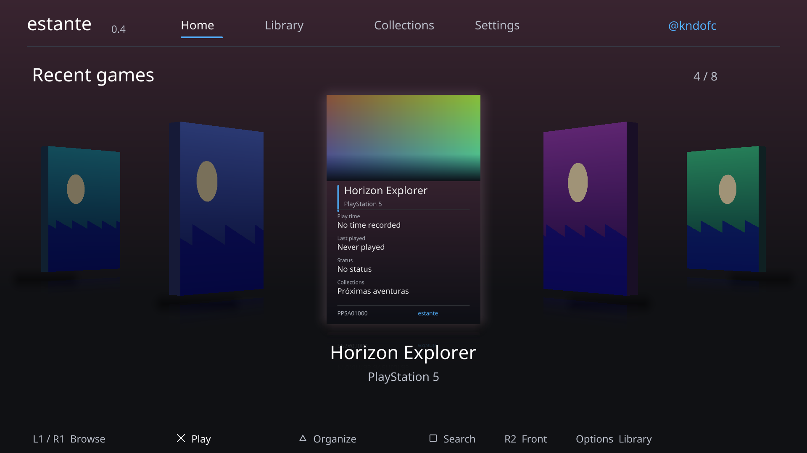 |
| **Launch: the case opens, the disc comes out** | |
| 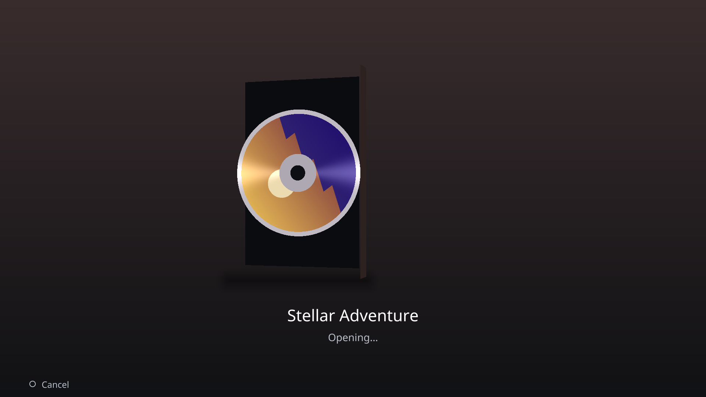 | |

O Estante organiza a biblioteca dentro do próprio aplicativo, sem mover jogos nem alterar o menu oficial. Lê jogos de PS5/PS4 pelo Elf Arsenal e importa títulos das pastas padrão em `/data` de PS5SX2 (PS2), SwanStationPS5 (PS1), Porpoise (GameCube/Wii) e PS5-ECAM (Wii U/3DS/DS). Ao selecionar um título importado de emulador, o Estante abre o emulador; a seleção do jogo é feita dentro dele. Não lê bibliotecas em USB/M.2 nem jogos de Switch; os títulos de 3DS/DS aparecem depois que o ECAM os escaneia. Abra cada emulador ao menos uma vez antes de atualizar o Estante. Requer Elf Arsenal e ShadowMountPlus; o teste de console disponível foi feito no firmware 11.60.

## Nova experiência

- Início com jogo em destaque, últimas escolhas feitas no Estante, jogos fixados e mosaicos de coleções.
- Biblioteca completa com busca sem distinção de acentos, filtros e ordenação.
- Coleções e subcoleções, seleção múltipla, favoritos, ocultos e classificação PS2/PS4/PS5.
- Coleções automáticas por plataforma, progresso manual e favoritos. Crie em Todos os jogos, sem busca textual ativa.
- Progresso manual: Quero jogar, Em andamento e Concluído. Não representa troféus ou leitura de saves.
- Fonte Inter com minúsculas e acentos; opção de texto maior e modo gravação persistentes.
- Capas locais PNG/JPEG, carregadas em segundo plano, com cache limitado. Nenhuma capa de jogo acompanha o projeto.
- Consulta ao estado do console antes de abrir um título e tentativa de confirmação posterior.
- Migração dos metadados v1 com cópia anterior preservada; exportação e restauração local.

As pastas existem dentro do Estante; os jogos não são movidos nem reorganizados no menu oficial.
PS2 instalado como PS4 exige classificação manual. O app roda no PS5 sem servidor no PC.
Recentes são pedidos feitos pelo Estante após a consulta inicial, não histórico global nem prova de abertura.

Veja [ESTANTE.md](ESTANTE.md) para controles, dados, instalação e limites e
[DESIGN.md](DESIGN.md) para as decisões de UX.

```sh
bash tools/test-estante.sh
bash tools/preview-estante.sh
```

Os previews `.local/preview-*.png` usam o renderizador real com dados e artes fictícias.
Servem apenas à validação de desenvolvimento; não são um aplicativo para o PC.

## Compilar (Linux / WSL Ubuntu)

```sh
sudo apt-get update
sudo apt-get install clang-18 llvm-18 lld-18 make ninja-build ccache curl wget unzip
make
```

O build baixa dependencias publicas fixadas por versao e hash. Saidas:
`dist/PPSA99841/` e `dist/PPSA99841.zip`.
Saída em pasta para ShadowMount; também pode ser empacotada como imagem `.ffpfsc`. Não é PKG.

## Enviar ao PS5

Com ShadowMount e FTP ativos, envie a pasta para `/data/homebrew/PPSA99841`.
Para uma instalacao nova pelo script, substitua o endereco de exemplo:

```sh
python3 tools/deploy-estante.py --host 192.0.2.10
```

O script usa FTP anonymous na porta 2121, confere os arquivos por SHA-256 e recusa
substituir um titulo ja registrado. Nao troca os payloads instalados.
Aparecendo o titulo Estante, abra pelo menu ou pela Biblioteca de jogos.

## Controles e testes

Direcional navega; X confirma; quadrado seleciona titulos; triangulo/Options abre
as acoes; L1/R1 muda pagina; circulo volta. No teclado, Options salva o nome.
Veja [ESTANTE.md](ESTANTE.md) para detalhes e limitacoes.

Testes da logica de catalogo, classificacao e pastas:

```sh
mkdir -p build/tests
clang-18 -g -fsanitize=address,undefined -c src/cJSON.c -o build/tests/cjson-host.o
clang++-18 -std=c++20 -g -fsanitize=address,undefined tests/test_estante.cpp src/library.cpp build/tests/cjson-host.o -o build/tests/test-estante
build/tests/test-estante
```

Esses testes nao validam o funcionamento no hardware. Os workflows originais da
base estao arquivados em `docs/upstream-workflows`, sem execucao automatica.

## Creditos e licenca

Autor do Estante: Kauan ([@kndofc](https://instagram.com/kndofc)).

Derivado de [ps5-native-app-boilerplate](https://github.com/blackbearreloaded/ps5-native-app-boilerplate),
de BlackBearReloaded, sob GPL-3.0-or-later. Os avisos de autoria foram preservados.
Documentacao original: [docs/UPSTREAM_README.md](docs/UPSTREAM_README.md).

- SDK publico: [ps5-payload-dev/sdk](https://github.com/ps5-payload-dev/sdk), v0.42.
- stb_image: MIT / dominio publico; origem fixada em [third_party/stb/SOURCE.md](third_party/stb/SOURCE.md).
- cJSON 1.7.19: MIT, veja [LICENSE-cJSON](LICENSE-cJSON).
- Licenca do projeto: [LICENSE](LICENSE); demais avisos: [THIRD_PARTY_NOTICES.md](THIRD_PARTY_NOTICES.md).

Dependencias baixadas, binarios gerados e dados pessoais do console nao sao versionados.
